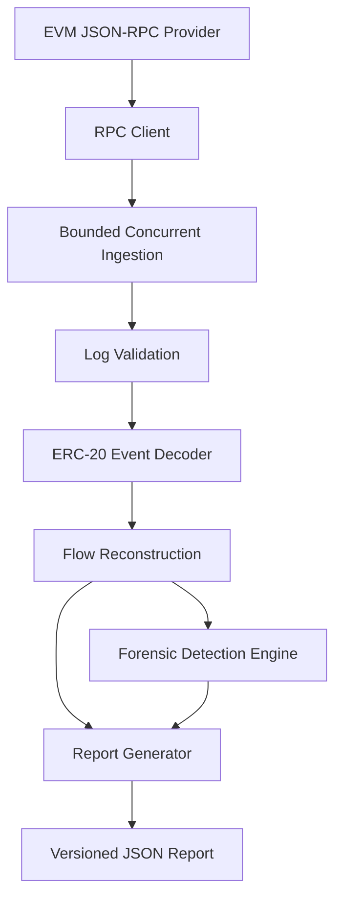

# EVM Forensics Engine

[](https://github.com/BlockchainInes/evm-forensics-engine/actions/workflows/ci.yml)


Deterministic ERC-20 transaction intelligence, address-level flow reconstruction, and heuristic forensic detection for EVM-compatible networks.

Implemented in Go with bounded concurrent RPC ingestion, strict event decoding, arbitrary-precision accounting, deterministic analysis, and versioned JSON reporting.

## Overview

EVM Forensics Engine analyzes on-chain ERC-20 Transfer and Approval events within a defined block range, reconstructs address-level token flows, and identifies transaction patterns relevant to digital asset investigations.

The engine separates data acquisition, event validation, flow reconstruction, forensic detection, and evidence reporting into independent components.

Its analytical model prioritizes reproducibility, explicit trust boundaries, bounded resource consumption, and transparent interpretation of heuristic findings.

### Core Capabilities

- Concurrent, rate-controlled Ethereum JSON-RPC ingestion
- Strict ERC-20 Transfer and Approval event decoding
- Arbitrary-precision token amount accounting
- Address-level and token-specific flow reconstruction
- Duplicate detection and conflicting log rejection
- Mint and burn event handling
- Maximum-value approval and subsequent outflow detection
- Multi-recipient transfer pattern detection
- Chronological circular transfer detection
- Deterministic, versioned JSON reporting
- Explicit analytical and evidentiary limitations

## System Architecture



| Component | Responsibility |
|---|---|
| `cmd/forensics` | CLI orchestration, configuration validation, execution scope |
| `internal/rpc` | JSON-RPC transport, concurrent ingestion, response validation |
| `internal/decoder` | ERC-20 event classification and strict ABI decoding |
| `internal/flow` | Deduplication, event ordering, token flow reconstruction |
| `internal/detection` | Deterministic heuristic detection and supporting evidence |
| `internal/report` | Versioned report construction and JSON serialization |

## RPC Security and Resilience

The RPC layer enforces explicit transport and ingestion constraints to reduce exposure to malformed responses, uncontrolled concurrency, excessive resource consumption, and transient provider failures.

| Control | Implementation |
|---|---|
| Endpoint validation | HTTP/HTTPS scheme validation, host validation, credential and fragment rejection |
| Redirect policy | Automatic HTTP redirects disabled |
| Response validation | JSON-RPC version and request identifier validation |
| Response size | Maximum response body of 16 MiB |
| Retry policy | Bounded retries with exponential backoff |
| Retry classification | Selected transient transport failures and HTTP 429, 502, 503, and 504 responses |
| Cancellation | Context-aware request execution and retry cancellation |
| Concurrency | Configurable client and ingestion concurrency limits |
| Rate control | Shared pacing of logical ingestion requests |
| Block scope | Maximum analysis range of 1,000 blocks |
| Log volume | Maximum accepted ingestion volume of 100,000 logs |
| Failure handling | Invalid or inconsistent ingestion data terminates analysis |

Logical request pacing does not impose an independent rate limit on individual HTTP retry attempts.

The accepted log limit is not an absolute process-memory limit.

## ERC-20 Event Decoding

The decoder recognizes the standard ERC-20 event signatures:

```solidity
Transfer(address indexed from, address indexed to, uint256 value)
Approval(address indexed owner, address indexed spender, uint256 value)
```

Validation covers:

- Event signature and topic structure
- Indexed address encoding and ABI padding
- Event data length and hexadecimal representation
- Unsigned 256-bit amount decoding
- Block, transaction, and log position quantities
- Removed supported-event rejection
- Unsupported event classification

Standard ERC-721 Transfer and Approval event layouts are excluded from ERC-20 decoding.

Token amounts are represented using arbitrary-precision integers. Accounting does not depend on floating-point arithmetic or token decimal normalization.

Event compatibility establishes structural conformity with the supported ERC-20 event layout. It does not establish contract authenticity or independently verify token balance changes.

## Flow Reconstruction

The reconstruction layer transforms decoded events into token-specific address-level flow records.

Reconstruction properties include:

- Deterministic ordering by block, transaction, and log position
- Duplicate event identification
- Conflicting event position rejection
- Block and transaction consistency validation
- Independent accounting across token contracts
- Arbitrary-precision aggregation
- Explicit mint and burn handling
- Deterministic output ordering

Flow reconstruction represents observed event-derived movements. It does not establish beneficial ownership, address attribution, or the provenance of individual fungible token units.

## Forensic Detection Rules

The detection engine applies three deterministic heuristic rules to decoded ERC-20 activity.

### R-01 — Maximum Approval Followed by Outflow

Identifies maximum-value ERC-20 approvals followed by outgoing token transfers from the approving address within the configured detection window.

**Analytical relevance**

Maximum-value allowances may represent persistent authorization exposure. Subsequent outflows provide a contextual signal for further investigation.

**Interpretation boundary**

The temporal relationship does not establish that the approved spender initiated the subsequent transfer. The rule does not independently reconstruct allowance consumption or transaction execution traces.

### R-02 — Multi-Recipient Transfer Pattern

Identifies outgoing transfers from an address to multiple distinct recipients within a configured block window.

The minimum recipient threshold is configurable. Detection uses non-overlapping qualifying windows.

**Analytical relevance**

Multi-recipient distribution patterns may be relevant to transaction dispersal analysis, automated distribution activity, and address-level behavioral assessment.

**Interpretation boundary**

Legitimate payment distribution, treasury operations, exchange activity, and automated settlement can produce comparable patterns.

### R-03 — Chronological Circular Transfer Pattern

Identifies chronological transfer paths that return to the originating address within the configured detection window and maximum cycle length.

Cycle exploration is bounded to 10,000 candidates per initial transfer.

**Analytical relevance**

Circular transfer structures may warrant additional examination in transaction network analysis and digital asset investigations.

**Interpretation boundary**

A detected address cycle does not establish that the same token units traversed the entire path. It does not independently establish wash trading, money laundering, common ownership, or coordinated activity.

### Detection Parameters

| Parameter | Default |
|---|---:|
| Detection window | 20 blocks |
| Minimum distinct recipients | 5 |
| Maximum cycle length | 5 hops |

All findings are heuristic indicators requiring contextual interpretation.

## Installation

### Requirements

- Go 1.27.0, as declared in `go.mod`
- Access to an EVM-compatible Ethereum JSON-RPC endpoint
- PowerShell or a compatible command-line environment

Build the executable from the repository root:

```powershell
go build -o forensics.exe ./cmd/forensics
```

No private keys, wallet credentials, transaction signing, or on-chain contract deployment are required.

## CLI Usage

Configure the RPC endpoint:

```powershell
$env:EVM_RPC_URL = "https://ethereum-sepolia-rpc.publicnode.com"
```

Execute a token-scoped analysis:

```powershell
.\forensics.exe `
  -from-block 12203000 `
  -to-block 12203050 `
  -token 0x1c7D4B196Cb0C7B01d743Fbc6116a902379C7238 `
  -window 20 `
  -min-recipients 5 `
  -max-cycle-hops 5 `
  -timeout 2m
```

### CLI Parameters

| Parameter | Description | Default |
|---|---|---|
| `-from-block` | First block, inclusive | Required |
| `-to-block` | Last block, inclusive | Required |
| `-token` | ERC-20 contract address filter | Unrestricted |
| `-window` | Detection window in blocks | `20` |
| `-min-recipients` | Minimum distinct recipients | `5` |
| `-max-cycle-hops` | Maximum cycle length | `5` |
| `-timeout` | Analysis context timeout | `2m` |

The analysis range is limited to 1,000 blocks.

An unrestricted token scope may exceed the query limits imposed by individual RPC providers. Token-scoped ingestion provides a more constrained acquisition strategy.

The configured timeout controls context-aware operations. CPU-bound reconstruction and detection are not independently interruptible.

## Report Schema

The engine produces structured JSON reports using schema version `1.1.0`.

Reports contain:

- Engine identification and schema version
- Chain identifier and analyzed block range
- Token filter and detection configuration
- Transfer and approval statistics
- Address-level flow records
- Duplicate and unsupported event counts
- Rule-specific forensic findings
- Supporting evidence
- Explicit analytical limitations

The reporting layer preserves deterministic ordering supplied by the reconstruction and detection components.

The report format supports downstream ingestion into investigation pipelines, analytical tooling, and case-review workflows.

## Live Network Validation

The complete acquisition, decoding, reconstruction, detection, and reporting pipeline was validated against Ethereum Sepolia using a public JSON-RPC endpoint.

### Analysis Scope

| Parameter | Value |
|---|---|
| Network | Ethereum Sepolia |
| Chain ID | `11155111` |
| First block | `12203000` |
| Last block | `12203050` |
| Block count | 51 |
| Token filter | `0x1c7D4B196Cb0C7B01d743Fbc6116a902379C7238` |
| Detection window | 20 blocks |
| Minimum recipients | 5 |
| Maximum cycle length | 5 hops |

### Observed Results

| Metric | Result |
|---|---:|
| Decoded transfers | 3,812 |
| Decoded approvals | 200 |
| Address flow records | 2,906 |
| Duplicate events | 0 |
| Unsupported events | 0 |
| Total heuristic findings | 408 |

### Detection Distribution

| Rule | Findings |
|---|---:|
| R-01 — Maximum Approval Followed by Outflow | 7 |
| R-02 — Multi-Recipient Transfer Pattern | 120 |
| R-03 — Chronological Circular Transfer Pattern | 281 |
| **Total** | **408** |

The results demonstrate successful processing of a live testnet dataset across the complete analytical pipeline.

The reported findings represent heuristic pattern matches, not verified incidents of illicit activity.

The dataset was obtained from a single RPC provider. Canonical chain membership, finality, and dataset completeness were not independently established.

## Validation and Test Coverage

The validation suite covers event decoding, RPC transport behavior, concurrent ingestion, flow reconstruction, forensic detection, report serialization, and end-to-end CLI execution.

All six packages passed the final local test execution. The initial GitHub Actions validation completed successfully, including race detection and both fuzz targets.

### Statement Coverage

| Package | Coverage |
|---|---:|
| `cmd/forensics` | 83.3% |
| `internal/decoder` | 96.9% |
| `internal/detection` | 95.7% |
| `internal/flow` | 97.2% |
| `internal/report` | 100.0% |
| `internal/rpc` | 72.7% |
| **Total statement coverage** | **85.0%** |

Aggregate statement coverage was confirmed by GitHub Actions using `go tool cover -func=coverage.out`.

### Core Function Coverage

| Function | Coverage |
|---|---:|
| `Decode` | 100.0% |
| `Reconstruct` | 98.7% |
| `detectApprovalOutflow` | 100.0% |
| `detectFanOut` | 100.0% |
| `detectCircularFlow` | 100.0% |
| `NewClient` | 100.0% |
| `parseQuantity` | 100.0% |

### Security-Oriented Validation

The test suite includes:

- Malformed event and ABI encoding rejection
- Invalid hexadecimal quantity rejection
- Integer overflow boundary validation
- Duplicate and conflicting event handling
- Token-specific accounting isolation
- JSON-RPC response validation
- HTTP redirect rejection
- Oversized response rejection
- Retry exhaustion and status classification
- Invalid client configuration rejection
- Cancellation during retry backoff
- Client and ingestion concurrency enforcement
- Ingestion rate control
- Out-of-range log rejection
- Maximum log volume enforcement
- Deterministic detection and reporting
- Report serialization failure handling

Statement coverage measures executed code paths. It does not establish the absence of defects or security vulnerabilities.

Supplementary RPC methods for transaction receipts, block retrieval, and finalized block retrieval remain outside the current test coverage.

## Fuzz Testing

Native Go fuzz testing was applied to the event decoder and hexadecimal RPC quantity parser.

### Recorded Local Fuzz Executions

| Fuzz Target | Observed Executions | Result |
|---|---:|---|
| `FuzzDecodeEvent` | 794,073 | PASS |
| `FuzzParseQuantity` | 698,235 | PASS |
| `FuzzParseQuantity` — additional run | 663,636 | PASS |
| **Total recorded executions** | **2,156,944** | **PASS** |

The recorded local fuzz runs completed without detected test failures.

Both fuzz targets also passed automated execution within GitHub Actions.

## Performance Benchmarks

Local Go benchmarks characterize the computational cost of event decoding, flow reconstruction, and heuristic detection.

| Operation | Observed Runtime | Allocation Profile |
|---|---:|---:|
| ERC-20 event decoding | 1.044–1.057 µs/op | 382 B/op, 12 allocs/op |
| Flow reconstruction, 1,000 synthetic logs | 2.64–2.82 ms/op | Approx. 1.49 MB/op, 15,103 allocs/op |
| Detection, 1,000 synthetic transfers | 1.03–1.09 ms/op | Approx. 1.56 MB/op, 1,045 allocs/op |

These measurements represent local benchmark observations using synthetic workloads.

They exclude network acquisition latency and do not constitute production throughput guarantees.

## Continuous Integration

The GitHub Actions workflow defines automated validation for pushes, pull requests, and manual execution.

The pipeline includes:

- Go toolchain configuration from `go.mod`
- Source formatting verification
- Full package build
- Static analysis using `go vet`
- Unit and integration tests
- Statement coverage generation
- Race detection with CGO enabled
- RPC quantity fuzz testing
- ERC-20 event decoder fuzz testing

The workflow uses read-only repository permissions and a bounded execution timeout.

### Validation Status

| Validation | Status |
|---|---|
| Source formatting | Passed |
| Build | Passed |
| Static analysis | Passed |
| Unit and integration tests | Passed |
| Statement coverage | 85.0% |
| Race detector execution | Passed |
| RPC fuzz testing | Passed |
| ERC-20 decoder fuzz testing | Passed |
| Local performance benchmarks | Completed |
| Live Sepolia analysis | Completed |
| Initial GitHub Actions execution | Passed |

### CI Validation Record

| Parameter | Result |
|---|---|
| Initial validated commit | `b0b8c6d` |
| Runner | Ubuntu |
| Workflow duration | 1m 58s |
| Race detection duration | 28s |
| Workflow result | Success |

No data races were detected during the recorded race-enabled test execution.

Validation records refer to the initial successful CI run. The CI badge reflects the current workflow status.

## Security Model and Analytical Limitations

The engine operates within an explicit provider-dependent trust model.

### Data Integrity

Structural validation, consistency checks, and deterministic ordering reduce the risk of processing malformed or internally conflicting event data.

They do not independently establish:

- RPC provider honesty
- Canonical chain membership
- Block finality
- Complete event retrieval
- Contract authenticity
- Correspondence between emitted events and actual token balance changes

### Evidentiary Boundaries

The engine does not perform:

- Real-world identity attribution
- Beneficial ownership determination
- Sanctions screening
- Transaction execution tracing
- Independent allowance consumption reconstruction
- Individual token-unit provenance tracking
- Legal or regulatory classification of detected activity

Heuristic findings require contextual assessment and corroborating evidence before investigative conclusions can be drawn.

### Computational Boundaries

Analysis is constrained by configured block ranges, accepted log volumes, response size limits, concurrency limits, detection windows, and bounded cycle exploration.

These controls limit specific dimensions of processing. They do not guarantee exhaustive detection across arbitrary transaction networks.

The absence of findings does not establish the absence of suspicious activity.

## Repository Structure

```text
evm-forensics-engine/
├── .github/
│   └── workflows/
│       └── ci.yml
├── cmd/
│   └── forensics/
│       ├── main.go
│       └── main_test.go
├── internal/
│   ├── decoder/
│   ├── detection/
│   ├── flow/
│   ├── report/
│   └── rpc/
├── .gitignore
├── go.mod
└── README.md
```

## Technical Domains

Blockchain Forensics · Digital Asset Intelligence · Ethereum JSON-RPC · ERC-20 Event Analysis · Transaction Flow Reconstruction · Heuristic Detection · Concurrent Systems · Defensive Engineering · Deterministic Reporting · Go

## License

Licensed under the MIT License.